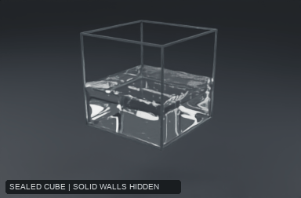
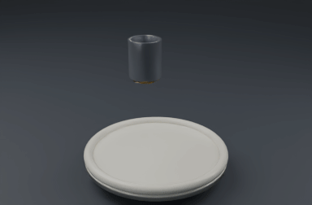

# Halation Fluid

**GPU liquid, smoke and fire simulation in Rust and wgpu.**

I built Halation Fluid from simulation kernels through reusable caches and a Houdini integration. It combines **FLIP/APIC liquids** with **Eulerian smoke and fire**, with numerical tests and visual comparisons guiding development.

Built by [Nat Bishop](https://github.com/nat-bishop), as part of [Halation](https://github.com/nat-bishop/halation). **Project showcase; source and installable packages private.**

*Moving boundaries: a prescribed drop and rotation drive the container while the liquid responds. The solid walls are hidden to reveal the surface.*

## What I built

- **GPU solvers:** particle/grid liquid simulation, pressure and density projection, adaptive substeps, viscosity, surface tension, and an Eulerian gas solver.
- **A usable simulation lifecycle:** persistent sessions, committed frame outputs, checkpoint recovery and cache reuse after edits.
- **Outputs for artists:** surface reconstruction, liquid particles and fields, OpenVDB gas volumes, and Cycles rendering from native caches.
- **Host integration:** geometry and animation inputs from Halation and a Houdini liquid SOP, with simulation state owned by the native engine.

## Liquid studies

*Viscous pouring: an animated source lays down a thick ribbon. The circular pattern follows the source motion.*

Both studies use a **64³ liquid grid** and four seconds of simulated motion, rendered in Cycles from Halation's native caches. They are development studies of specific behaviors.

## Engineering the engine

The liquid solver couples particles to a staggered velocity grid. Dense and narrow-band storage support different workloads; the gas solver uses sparse GPU storage and exports OpenVDB volumes.

A shared native session handles batch and persistent execution. Hosts evaluate geometry, animation and units; the engine owns simulation state, checkpoints and committed results. This boundary lets the liquid engine serve both Halation and the Houdini integration.

## Every change had to earn its place

- **Benchmark gates.** I tracked compute cost alongside divergence, finite values, bounded mass and deterministic replay. A faster result had to preserve the relevant numerical checks.
- **Testing the reference itself.** I built a high-accuracy golden solve, then found that comparing against it favored the advection method used to create it. Analytical advection tests and energy spectra replaced that score as acceptance criteria. They confirmed a useful improvement and rejected a noisier alternative that initially looked more detailed.
- **Blind visual rankings.** I watched real flume footage, then ranked shuffled simulation variants before revealing their settings. These were my own recorded judgments, anchored to real water. The results exposed differences between numerical accuracy and visual preference, including a preference for a softer surface-tension variant in one later comparison.

### Historical smoke performance

Dense smoke benchmark, **June 23, 2026**, on an **NVIDIA RTX PRO 6000 Blackwell Workstation Edition**. Configuration: `consistent-mg-mac`, four multigrid V-cycles.

| Grid | Measured time per simulation step |
|---|---:|
| 128³ | 3.12 ms |
| 256³ | 8.08 ms |
| 384³ | 30.71 ms |

These are simulation-only measurements, excluding rendering and cache output. They describe this historical dense-gas configuration; liquid and current sparse workloads have different costs.

## Inside Houdini

The liquid engine also runs behind a Houdini SOP asset with three inputs: **initial liquid, liquid source and collider**. Ordinary SOP geometry and animation drive the simulation. The node returns particles, fields or a native surface mesh, with Houdini's Particle Fluid Surface and File Cache available downstream.

Houdini owns scene evaluation and presentation; a persistent native process owns the solve and its cache. The tested configuration was **Houdini 22.0.368 Apprentice on Windows 11**, using NVIDIA hardware and Vulkan.

**Stack:** Rust · wgpu · WGSL · Python · Houdini · OpenVDB · Cycles

## Status and contact

Active development. This repository presents selected simulation studies and the engineering behind them. Source and installable packages remain private.

For a demo or technical walkthrough, contact me through [LinkedIn](https://www.linkedin.com/in/nat-bishop/). See [Halation](https://github.com/nat-bishop/halation) for the procedural authoring application and [my profile](https://github.com/nat-bishop) for other projects.

© 2026 Nat Bishop. All rights reserved.
