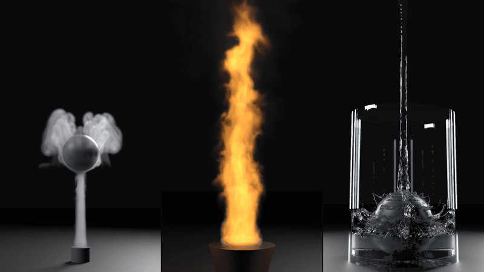
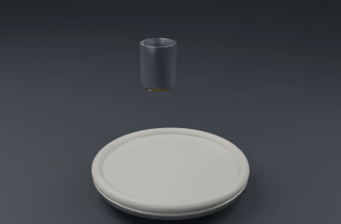
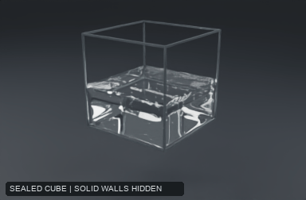

# Halation Fluid

*Smoke (384 × 384 × 384 cells), fire (264 × 384 × 264) and FLIP/APIC liquid (192 × 384 × 192, sparse), simulated on the GPU and rendered in Cycles. A four-second excerpt of the clip below.*

**GPU liquid, smoke and fire simulation in Rust and wgpu.** I built Halation Fluid from simulation kernels through resumable caches and a Houdini integration. It combines **FLIP/APIC liquids** with **sparse Eulerian smoke and fire**, and every change to a solver had to pass numerical tests and visual comparisons before it was kept.

Built by [Nat Bishop](https://github.com/nat-bishop), as part of [Halation](https://github.com/nat-bishop/halation). **Project showcase; source and installable packages private.**

## What it shows

- **Three solvers on one engine.** FLIP/APIC liquid, and sparse GPU smoke and fire, simulated natively and rendered in Cycles.
- **Production-shaped outputs.** Surface meshes, particles and fields for liquids; OpenVDB volumes for gas; caches that survive edits and resume.
- **Measured, not eyeballed.** Benchmark gates on divergence, mass and deterministic replay, an audited reference solve, and blind visual rankings.
- **Runs inside Houdini.** A SOP asset drives the native liquid engine from ordinary Houdini geometry.

## Smoke, fire and liquid

<!-- VIDEO PLACEHOLDER: in GitHub's web editor, drag halation-fluid-showcase.mp4 onto this line.
     GitHub uploads it to user-attachments and replaces this comment with a link that plays inline.
     A committed .mp4 file does not play. Delete this comment once the video is in. -->

*20 seconds, captioned. Each panel is one simulation played at normal speed and rendered in Cycles. The spheres, nozzle, brazier and glass are static set pieces and colliders. The flame's colour comes from Halation's fire colour ramp, and the warm light on the brazier comes from two static lights.*

## What I built

- **GPU solvers:** particle/grid liquid simulation, pressure and density projection, adaptive substeps, viscosity, surface tension, and a sparse Eulerian gas solver for smoke and fire.
- **A usable simulation lifecycle:** persistent sessions, committed frame outputs, checkpoint recovery and cache reuse after edits.
- **Outputs for artists:** surface reconstruction, liquid particles and fields, OpenVDB gas volumes, and Cycles rendering from native caches.
- **Host integration:** geometry and animation inputs from Halation and a Houdini liquid SOP, with simulation state owned by the native engine.

## Liquid studies

| Viscous pouring | Moving boundaries |
|---|---|
|  |  |

*Development studies of specific behaviors on a 64³ liquid grid, four seconds of simulated motion each, rendered in Cycles from Halation's native caches. Left: an animated source lays down a thick ribbon. Right: a prescribed drop and rotation drive a closed container; its walls are hidden to reveal the surface.*

## Engineering the engine

The liquid solver couples particles to a staggered velocity grid. Dense and narrow-band storage support different workloads; the gas solver uses sparse GPU storage and exports OpenVDB volumes.

A shared native session handles batch and persistent execution. Hosts evaluate geometry, animation and units; the engine owns simulation state, checkpoints and committed results. This boundary lets the liquid engine serve both Halation and the Houdini integration.

## Every change had to earn its place

- **Benchmark gates.** I tracked compute cost alongside divergence, finite values, bounded mass and deterministic replay. A faster result had to preserve the relevant numerical checks.
- **Testing the reference itself.** I built a high-accuracy golden solve, then found that comparing against it favored the advection method used to create it. Analytical advection tests and energy spectra replaced that score as acceptance criteria. They confirmed a useful improvement and rejected a noisier alternative that initially looked more detailed.
- **Blind visual rankings.** I watched real flume footage, then ranked shuffled simulation variants before revealing their settings. These were my own recorded judgments, anchored to real water. The results exposed differences between numerical accuracy and visual preference, including a preference for a softer surface-tension variant in one later comparison.

### Historical smoke performance

Dense smoke benchmark, **June 23, 2026**, on an **NVIDIA RTX PRO 6000 Blackwell Workstation Edition**. Configuration: `consistent-mg-mac`, four multigrid V-cycles.

| Grid | Measured time per simulation step |
|---|---:|
| 128³ | 3.12 ms |
| 256³ | 8.08 ms |
| 384³ | 30.71 ms |

These are simulation-only measurements, excluding rendering and cache output. They describe this historical dense-gas configuration; liquid and current sparse workloads have different costs.

## Inside Houdini

The liquid engine also runs behind a Houdini SOP asset with three inputs: **initial liquid, liquid source and collider**. Ordinary SOP geometry and animation drive the simulation. The node returns particles, fields or a native surface mesh, with Houdini's Particle Fluid Surface and File Cache available downstream.

Houdini owns scene evaluation and presentation; a persistent native process owns the solve and its cache. The tested configuration was **Houdini 22.0.368 Apprentice on Windows 11**, using NVIDIA hardware and Vulkan.

**Stack:** Rust · wgpu · WGSL · Python · Houdini · OpenVDB · Cycles

## Status and contact

Active development. This repository presents selected simulation studies and the engineering behind them. Source and installable packages remain private.

For a demo or technical walkthrough, contact me through [LinkedIn](https://www.linkedin.com/in/nat-bishop/). See [Halation](https://github.com/nat-bishop/halation) for the procedural authoring application and [my profile](https://github.com/nat-bishop) for other projects.

© 2026 Nat Bishop. All rights reserved.
